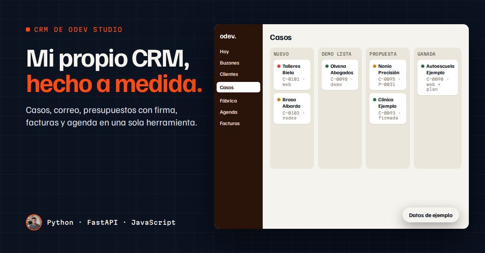
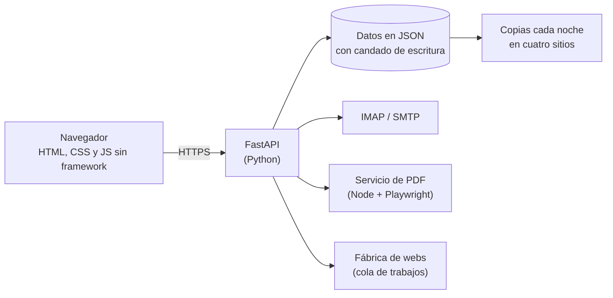

# CRM de Odev Studio

El CRM con el que llevo mi agencia, [Odev Studio](https://odev.es). Lo escribí yo porque necesitaba que el correo, los casos, los presupuestos, las facturas y la fábrica de demos estuvieran en un solo sitio, y que funcionara en mi propio servidor.

> **Repositorio de presentación.** El código es privado porque trabaja con datos de clientes reales. Aquí explico qué hace y cómo está montado. Todas las imágenes llevan datos y marcas de ejemplo.

## Qué hace

| Parte | Qué resuelve |
|---|---|
| **Casos** | Cada conversación con un cliente es un caso con número (`C-0001`…), etapa, prioridad, responsable y plazo. Tablero tipo Trello en el que se arrastra cada caso a su columna. |
| **Buzones** | Lee el correo por IMAP cada dos minutos, lo reparte por buzón, lo asigna a su caso (por el número del asunto o por el hilo) y responde por SMTP desde el remitente correcto. Plazo de 24 h: lo que se pasa sale en rojo. |
| **Clientes** | Ficha de 360°: productos contratados, casos, contactos, correos y conversaciones. Avisa de los duplicados por teléfono, dominio o correo. Cada dato guarda de dónde salió y quién lo puso. |
| **Presupuestos** | Asistente paso a paso, IVA siempre visible, empresa o particular. El cliente firma desde un enlace y se guarda la copia en PDF con una huella SHA-256. |
| **Facturas** | Borradores a partir de los contratos y de los presupuestos firmados. El número legal lo pone el programa de facturación; el CRM no emite facturas legales. |
| **Agenda y jornada** | Todo lo que tiene fecha, por días, exportable a calendario (.ics). Control de jornada en el que corregir un fichaje exige un motivo y deja rastro. |
| **Fábrica** | Pide una web de demostración a la [fábrica de webs con IA](https://github.com/Oscar-Odev/fabrica-webs-ia) y mueve el caso solo cuando la demo está lista para revisar. |

## Cómo está hecho

- **Servidor:** Python con FastAPI, dentro de Docker, en mi [servidor de casa](https://github.com/Oscar-Odev/homelab-showcase).
- **Interfaz:** HTML, CSS y JavaScript propios, sin framework, con Chart.js para las gráficas.
- **Datos:** ficheros JSON con un candado único (`flock`). Cualquier programa que escriba en ellos pasa por el mismo candado y solo cambia los campos que ha tocado, así que dos escrituras a la vez no se pisan. Lo probé con 120 escrituras cruzadas y no se perdió ninguna.
- **PDF:** un pequeño servicio con Node y Playwright convierte los presupuestos en PDF.
- **Copias:** antes de cada cambio se guarda una copia; además, el fichero cifrado se sube cada hora si ha cambiado y entra en las copias de cada noche.

## Seguridad

- Solo se abre desde casa o por Tailscale. Desde internet no existe.
- PIN propio con PBKDF2, bloqueo tras cinco intentos fallidos y cookie `HttpOnly`, `Secure` y `SameSite=Strict`.
- Política de seguridad de contenido (CSP) estricta: nada de JavaScript en línea.
- La API rechaza cualquier campo que parezca una contraseña o un token: las claves nunca se guardan en el CRM.

## Pruebas

Antes de cada cambio en el servidor se levanta una copia aparte con los datos copiados y se pasa una batería de pruebas de la API: alta de cliente, duplicados, caso, etapas, propuesta firmada, fusión de casos, renovaciones, jornada y facturas. Los recorridos de pantalla (alta, firma, emitir factura) se prueban con Playwright.

---

Óscar Carreras · [portfolio.odev.es](https://portfolio.odev.es) · [LinkedIn](https://www.linkedin.com/in/oscarcarrerasyague)
